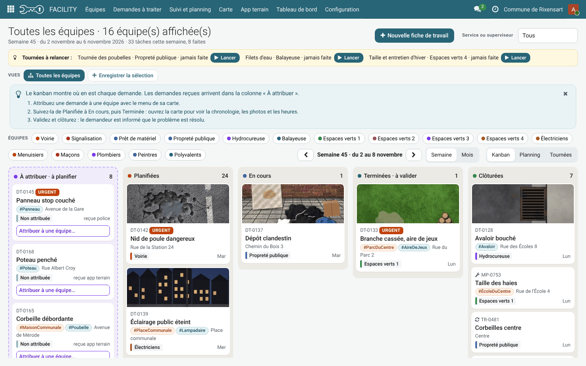
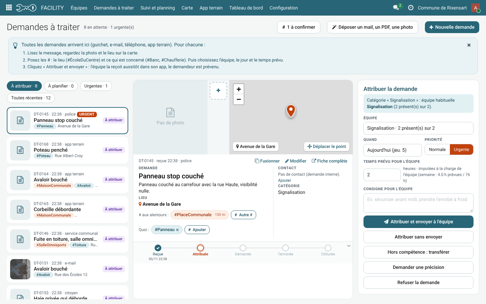
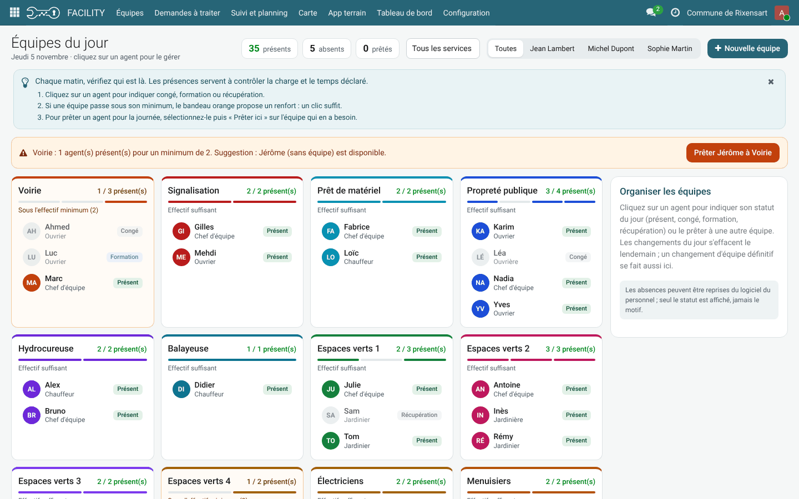
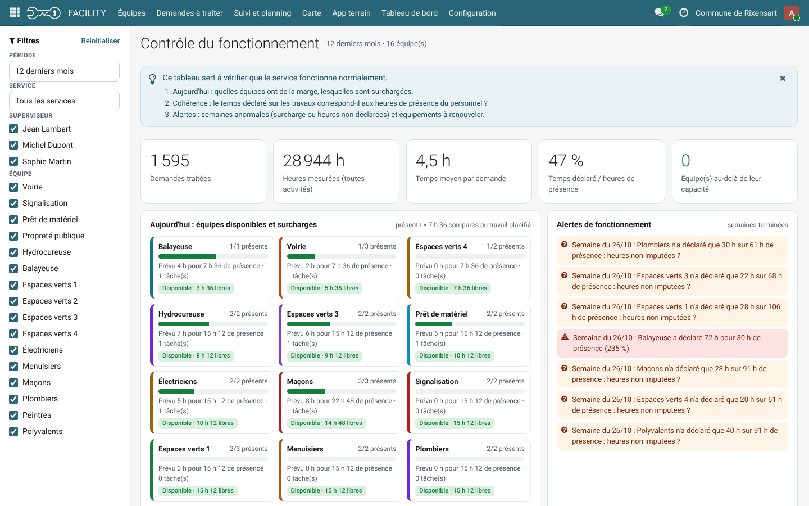
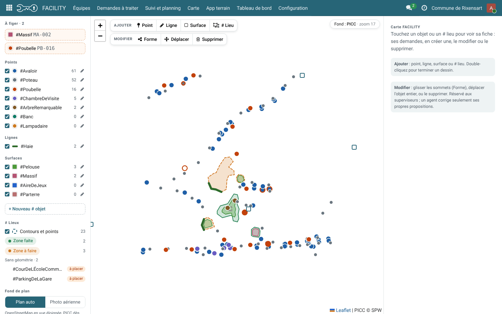
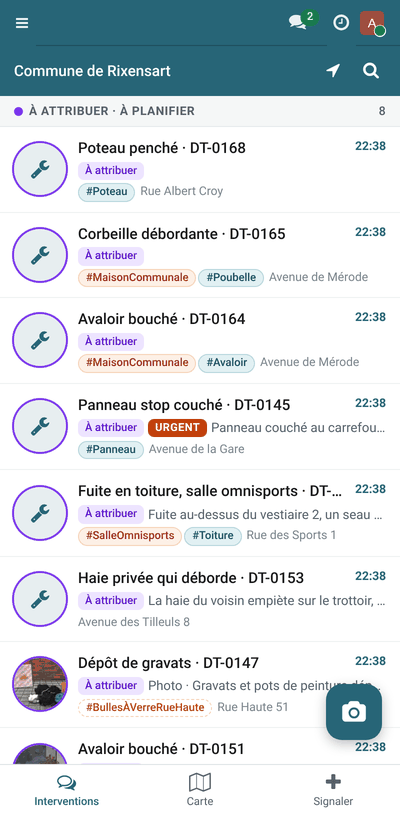

# FACILITY — service technique communal pour Odoo 19

FACILITY gère le service technique d'une commune : demandes de travaux, équipes, planning par semaine, application terrain sur smartphone, tournées et entretiens planifiés, et carte du patrimoine (# lieux et # objets).

Les modules suivent les conventions de l'[Odoo Community Association (OCA)](https://odoo-community.org) : un dossier par module, manifeste au format OCA, documentation dans `readme/` et `README.rst`, licence LGPL-3.



## Modules

| Module | Version | Nom | Résumé |
|---|---|---|---|
| [service_travaux](service_travaux/) | 19.0.1.14.0 | FACILITY | Gestion du service technique de maintenance : demandes, équipes, planning, app terrain, # lieux |
| [service_travaux_carte](service_travaux_carte/) | 19.0.0.2.1 | FACILITY – Carte | Objets recensés (points, lignes, surfaces) et # lieux sur la carte : dessin et édition, import SPW / WFS / ODWB / QGIS, propositions depuis l'app terrain |
| [service_travaux_demo](service_travaux_demo/) | 19.0.1.10.0 | FACILITY – données de démonstration | Équipes, agents, demandes et 12 mois d'historique fictifs (maquette Rixensart) |

`service_travaux` est l'application principale. `service_travaux_carte` ajoute la carte. `service_travaux_demo` contient des données fictives pour les démonstrations : à ne pas installer en production.

## Captures d'écran

Captures prises avec les données de démonstration (personnes et demandes fictives).

### Demandes à traiter
Chaque demande arrive ici (guichet, e-mail, téléphone, app terrain). On pose les # lieux et # objets, puis on l'attribue à une équipe avec un jour et un temps prévu.



### Équipes du jour
Présences de chaque équipe, absences (congé, formation, récupération) et prêt d'un agent pour la journée.



### Tableau de bord
Équipes disponibles ou surchargées, cohérence entre heures déclarées et présences, alertes par semaine.



### Carte
Objets recensés en points, lignes et surfaces, # lieux et zones de tournée, propositions des agents à figer. Fonds de plan OpenStreetMap, PICC et photo aérienne (non affichés sur cette capture).



### App terrain
Sur smartphone : le travail de l'équipe, la carte et le signalement avec photo.



## Prérequis

- Odoo 19.0 (Community ou Enterprise)
- Modules Odoo standards : `mail`, `hr`, `bus`
- Python : `requests` (pour `service_travaux_carte`), voir `requirements.txt`
- Accès Internet depuis le serveur pour les fonds de plan et les imports géographiques en ligne

## Installation

```bash
cd /chemin/vers/vos/addons
git clone -b 19.0 https://github.com/Tomacbe/facility.git
pip install -r facility/requirements.txt
```

Ajoutez le dossier `facility` au paramètre `addons_path` de votre fichier de configuration Odoo, redémarrez Odoo, puis installez **FACILITY** depuis le menu Applications (ou `-i service_travaux,service_travaux_carte`).

## Base de démonstration

Le script `creer_base_test.sh` recrée une base `facility_test` complète (FACILITY, données de démonstration, carte et démo « maison communale ») dans une installation Docker d'Odoo 19 :

```bash
./creer_base_test.sh            # base facility_test
./creer_base_test.sh ma_base    # autre nom
```

Il suppose des conteneurs nommés `odoo19_web_1` et `odoo19_db_1` ; adaptez ces noms au besoin. Connexion : `admin` / `admin`.

## Documentation

Chaque module a son propre `README.rst` : description, configuration, utilisation et captures.

## Licence

[LGPL-3](LICENSE) — GNU Lesser General Public License v3.0.

## Mainteneur

[@Tomacbe](https://github.com/Tomacbe)
