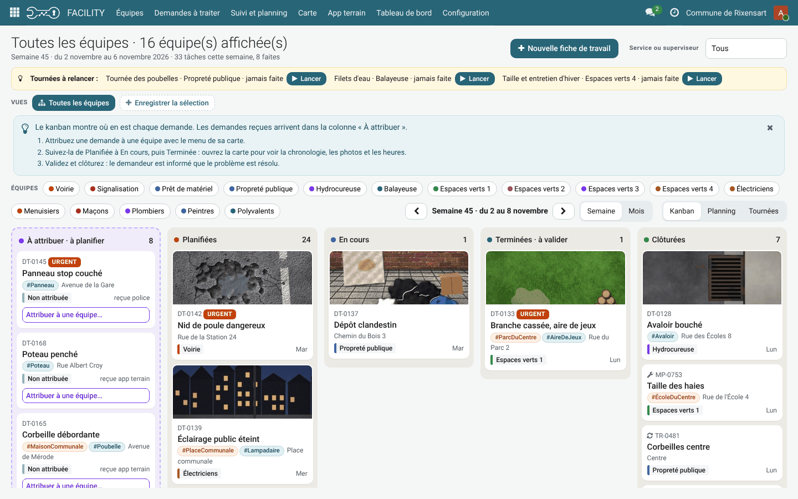
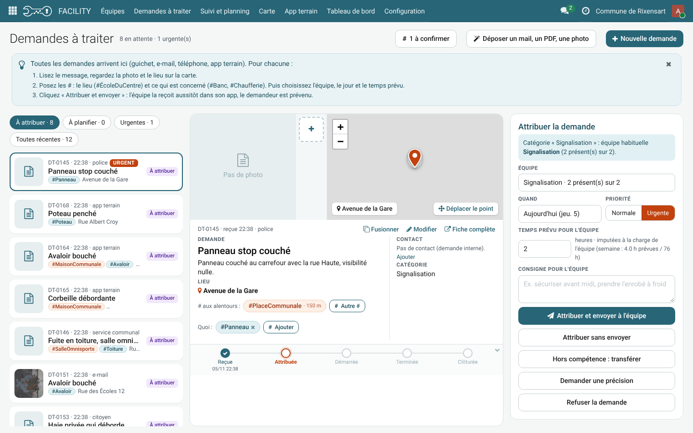
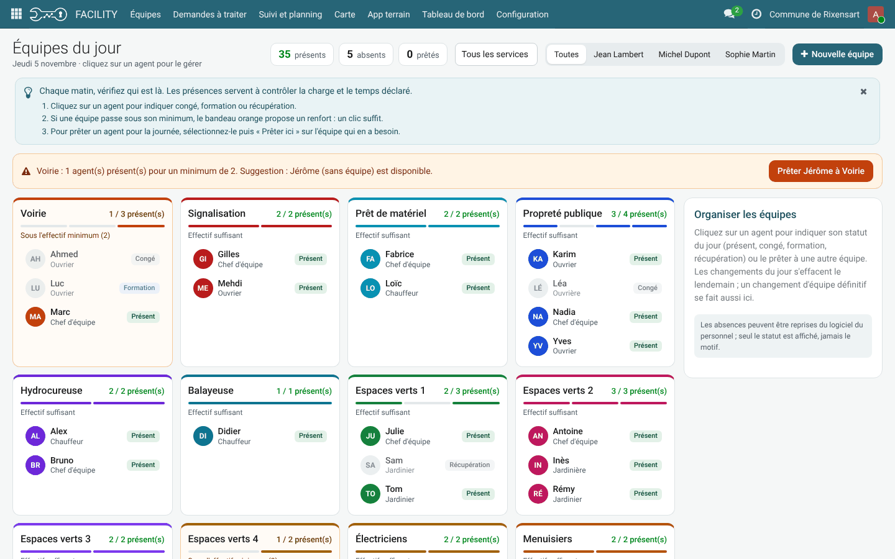
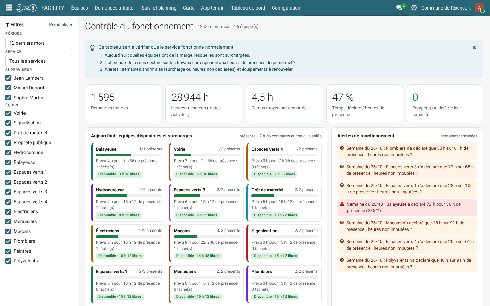
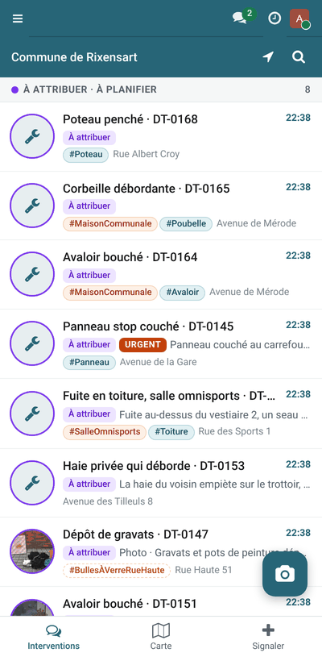

========
FACILITY
========

.. |badge1| image:: https://img.shields.io/badge/maturity-Beta-yellow.png
    :alt: Beta
.. |badge2| image:: https://img.shields.io/badge/licence-LGPL--3-blue.png
    :target: http://www.gnu.org/licenses/lgpl-3.0-standalone.html
    :alt: License: LGPL-3
.. |badge3| image:: https://img.shields.io/badge/github-Tomacbe%2Ffacility-lightgray.png?logo=github
    :target: https://github.com/Tomacbe/facility/tree/19.0/service_travaux
    :alt: Tomacbe/facility

|badge1| |badge2| |badge3|

FACILITY est l'outil de gestion du service technique d'une commune (voirie, bâtiments, espaces verts, propreté publique). Il suit chaque demande de travaux depuis son encodage jusqu'à sa clôture sur le terrain.

Une demande se décrit en trois blocs : **Demande** (quoi), **Lieu** (où) et **Contact** (qui). Les étiquettes **# lieux** (#MaisonCommunale, #ParcDuMoulin…) et **# objets** (#Avaloir, #Banc, #Poubelle…) construisent au fil du temps des jeux de données sur le patrimoine communal.

Fonctions principales :

- Demandes à traiter : le secrétariat encode ou reçoit la demande et l'attribue à une équipe.
- Suivi et planning : kanban par numéro de semaine, report automatique d'une semaine à l'autre, refus d'une demande, annulation d'un bon de travail.
- Équipes et présences : organigramme (département, services, contremaîtres, brigadiers, équipes), présences du jour, maximum 7,5 h par agent et par jour.
- App terrain pour smartphone : travail planifié de l'équipe, démarrer / terminer, photo avant et après, localisation sur la carte, confirmation des agents présents à la clôture.
- Entretiens planifiés et tournées : liste de zones validée une par une (espaces verts, un bon de travail par zone) ou en lot (tournée des poubelles, pourcentage réalisé).
- Heures des équipes : temps passé × nombre d'agents confirmés.
- Demandeurs avec compte : encodent leurs demandes et en suivent l'avancement.
- Tableau de bord de la direction et analyses en tableaux croisés.
- Assistant IA (optionnel) pour aider à classer et rédiger les demandes.

Configuration
=============

Après l'installation, dans **FACILITY > Configuration** :

1. **Réglages** : nom de la commune, rôles, pointeuse. Seul l'administrateur peut modifier ces paramètres.
2. **Organigramme (services)** puis **Équipes** : services, contremaîtres, brigadiers et équipes.
3. **Agents (présences)** : relier chaque employé à son équipe.
4. **Catégories de demandes** et **Contacts de transfert** (services compétents en dehors du service technique).
5. **Tournées** et **Circuits et actions récurrentes** pour les entretiens planifiés.
6. **Assistant IA** : facultatif, nécessite une clé API.

Donner ensuite à chaque utilisateur l'un des rôles suivants :

- **Équipe terrain** : app terrain uniquement.
- **Demandeur** : encode ses demandes et les suit.
- **Superviseur** : attribue, planifie et clôture le travail de ses équipes.
- **Secrétariat** et **Direction** : vue globale.

Utilisation
===========

- **Demandes à traiter** : encoder une demande (quoi, où, qui) et l'attribuer à une équipe.
- **Suivi et planning** : écran d'accueil. Kanban ouvert sur la semaine en cours, avec passage à une autre semaine ou au mois. Ce qui n'est pas clôturé en semaine 1 glisse en semaine 2.
- **App terrain** : sur smartphone, l'équipe voit son travail planifié, le démarre, le termine avec photo et confirme les agents présents.
- **Tableau de bord** et **Vue d'ensemble** : indicateurs pour la direction.

Captures d'écran
================

    Suivi et planning : kanban de la semaine, de « À attribuer » à « Clôturées »

    Demandes à traiter : lecture de la demande, lieu sur la carte et attribution à une équipe

    Équipes du jour : présences, absences et prêt d'un agent à une autre équipe

    Tableau de bord : charge des équipes, heures déclarées et alertes

    App terrain sur smartphone

Signaler un problème
====================

Les bogues sont suivis dans les `issues GitHub <https://github.com/Tomacbe/facility/issues>`_.

Crédits
=======

Auteur
------

- Tomacbe

Contributeurs
-------------

- Tomacbe

Autres crédits
--------------

Bibliothèques incluses dans static/ :

- Leaflet (licence BSD-2-Clause), https://leafletjs.com
- Police Roboto (licence SIL Open Font License 1.1), https://fonts.google.com/specimen/Roboto

Mainteneur
----------

Ce module est maintenu par `Tomacbe <https://github.com/Tomacbe>`_.

Il fait partie du dépôt `Tomacbe/facility <https://github.com/Tomacbe/facility/tree/19.0/service_travaux>`_.
