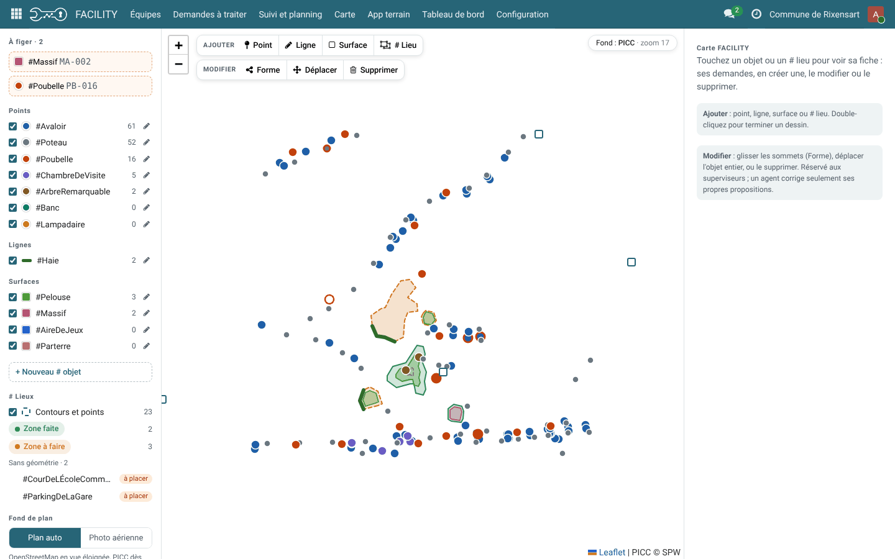

================
FACILITY – Carte
================

.. |badge1| image:: https://img.shields.io/badge/maturity-Alpha-yellow.png
    :alt: Alpha
.. |badge2| image:: https://img.shields.io/badge/licence-LGPL--3-blue.png
    :target: http://www.gnu.org/licenses/lgpl-3.0-standalone.html
    :alt: License: LGPL-3
.. |badge3| image:: https://img.shields.io/badge/github-Tomacbe%2Ffacility-lightgray.png?logo=github
    :target: https://github.com/Tomacbe/facility/tree/19.0/service_travaux_carte
    :alt: Tomacbe/facility

|badge1| |badge2| |badge3|

Ajoute une carte à FACILITY pour situer et éditer le patrimoine suivi par le service technique.

- **Objets recensés** : chaque # objet a une géométrie, point (#Avaloir, #Banc), ligne (#Haie, longueur calculée) ou surface (#Pelouse, #Massif, surface en m²). Les objets sont rangés automatiquement dans le # lieu ou la zone de tournée qui les contient.
- **# lieux** : un # lieu sans géométrie reçoit un contour ou un point depuis la carte.
- **Outils de dessin** : ajouter, modifier la forme (sommets), déplacer, supprimer. La suppression est réservée au superviseur ; un objet ou un # lieu déjà utilisé est archivé plutôt que supprimé.
- **Fonds de plan** : OpenStreetMap en vue éloignée, PICC (Service public de Wallonie) à partir du zoom 17, photo aérienne à la demande.
- **Import** : catalogue ArcGIS REST du SPW, service WFS, ODWB (Open Data Wallonie-Bruxelles) et fichiers QGIS (GeoJSON, GeoPackage, Shapefile zippé ; Lambert 72 et Lambert 2008 convertis). Les entités sont classées par valeur d'un champ vers un # objet ou un # lieu. Un nouvel import met à jour sans créer de doublon et n'écrase pas une forme corrigée à la main.
- **App terrain** : bouton « Carte » ; l'agent propose un objet (point, ligne, surface) et peut retirer sa proposition. Le superviseur le fige ou le refuse depuis « À figer ».
- Une demande peut viser un objet précis.

Configuration
=============

Dans **FACILITY > Configuration > Carte** :

- **# objets de la carte** : choisir la géométrie (point, ligne, surface), la couleur et le préfixe de chaque # objet. La géométrie est verrouillée dès qu'il existe des objets.
- **Importer des données** : choisir la source (SPW, WFS, ODWB ou fichier), la couche, puis le classement des entités.
- **Préparer la démo « maison communale »** : charge un jeu d'exemple autour de la maison communale de Rixensart.

Les fonds de plan et les imports en ligne demandent un accès Internet depuis le serveur Odoo. Le module utilise la bibliothèque Python requests.

Utilisation
===========

- **FACILITY > Carte** : colonne des # par géométrie, liste « À figer » et # lieux sans géométrie. Cliquer sur un objet ouvre sa fiche (mesure, demandes liées, Figer / Refuser, forme, déplacer, supprimer).
- **App terrain > Carte** : signaler ou proposer un objet sur place.

Captures d'écran
================

    Carte : objets recensés (points, lignes, surfaces), # lieux, objets à figer et outils de dessin

Signaler un problème
====================

Les bogues sont suivis dans les `issues GitHub <https://github.com/Tomacbe/facility/issues>`_.

Crédits
=======

Auteur
------

- Tomacbe

Contributeurs
-------------

- Tomacbe

Mainteneur
----------

Ce module est maintenu par `Tomacbe <https://github.com/Tomacbe>`_.

Il fait partie du dépôt `Tomacbe/facility <https://github.com/Tomacbe/facility/tree/19.0/service_travaux_carte>`_.
